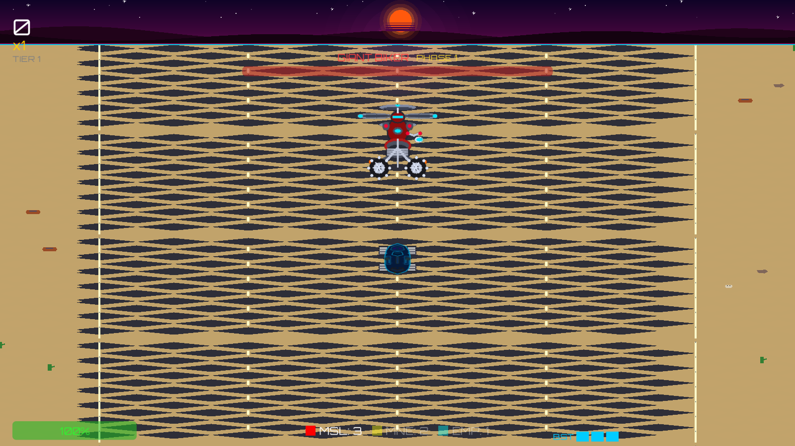
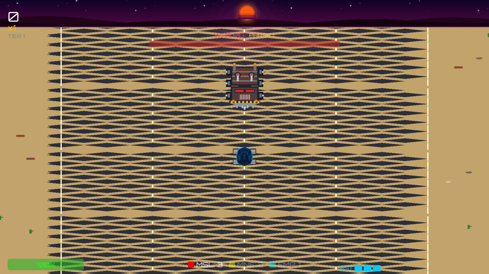
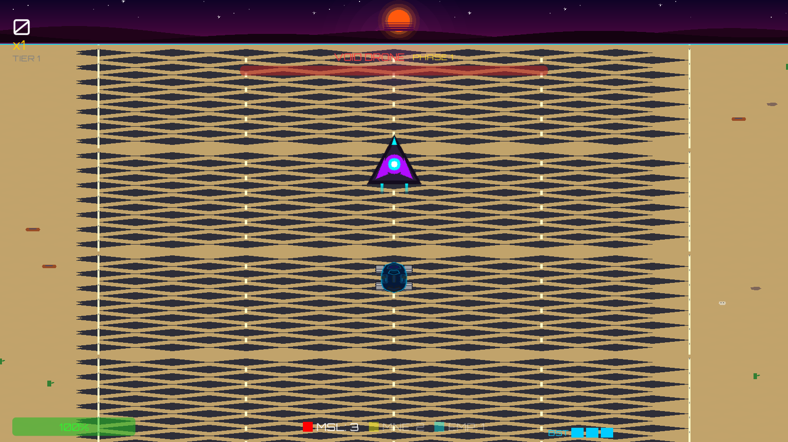

# Race to Dead End - Boss Guide

Boss encounters trigger every **3,000 points** (`Constants.BOSS_SCORE_INTERVAL`). During an active boss fight, normal wave spawning pauses (`GameManager.boss_active = true`), the HUD displays the boss health bar and phase indicator, and defeating a boss awards **1,000 points** (`Constants.BOSS_SCORE`), unlocks new enemy tiers, and plays the boss defeat overlay (`demo/DemoBoss*.tscn`).

## Boss Progression Overview (Appearance Order)

| Order | Boss | Boss Key | Appearance Trigger | HP | Attack Interval | Unlocks on Defeat / Role |
|---|---|---|---|---|---|---|
| 1 | Cyber Bunny | `boss_bunny` | 3,000 pts | 25 | 1.5s | Rotor waves & **Urban Camo** car skin |
| 2 | Giant Biker | `boss_giant_biker` | 6,000 pts | 35 | 1.5s (0.9s enraged) | Scav & Sasquatch waves |
| 3 (Mini-Boss) | Sasquatch | `sasquatch` | Waves after 2nd boss (`bosses_killed >= 2`) | 15 | 2.25s | Recurring heavy brute (`300` pts/kill) |
| 4 | War Rig | `boss` | 9,000 pts | 60 | 1.5s | Void Drone waves |
| 5+ | Void Drone | `boss_void_drone` | 12,000+ pts | 45 | 2.25s | Repeats on subsequent 3,000-pt tiers |

---

## 1. Cyber Bunny (`BossBunny`)

- **HUD Title:** `CYBER BUNNY`
- **Scene / Script:** `scenes/enemies/BossBunny.tscn`, `scripts/scenes/enemies/BossBunny.gd`
- **HP:** `25` (`Constants.BOSS_BUNNY_HP`)
- **Score Reward:** `1,000` (`Constants.BOSS_SCORE`)
- **Behavior & Attacks:**
  - Maintains a `350px` lead ahead of the player on the highway while crushing road obstacles on contact.
  - Features a pulsating red-eye shader and armored cybernetic chest plate.
  - Every `1.5s`, drops a `BabyBunnyBomb` (`scenes/weapons/BabyBunnyBomb.tscn`) directly ahead of the player.
- **Progression:** Defeating Cyber Bunny triggers `demo/DemoBossBunny.tscn`, transitions regular waves from Bunnies to Rotors (`bosses_killed >= 1`), and permanently unlocks the **Urban Camo** Interceptor skin (`GameManager.first_boss_defeated`).

---

## 2. Giant Biker (`BossGiantBiker`)

- **HUD Title:** `GIANT BIKER`
- **Scene / Script:** `scenes/enemies/BossGiantBiker.tscn`, `scripts/scenes/enemies/BossGiantBiker.gd`
- **HP:** `35` (`Constants.BOSS_GIANT_BIKER_HP`)
- **Score Reward:** `1,000` (`Constants.BOSS_SCORE`)
- **Behavior & Attacks:**
  - Tracks the player horizontally while pacing `350px` ahead on a rotor-crowned spiked motorcycle.
  - Attacks with a sweeping `ChainSwing` (`scenes/weapons/ChainSwing.tscn`) melee arc.
  - **Enrage (< 50% HP):** Glows red, increases speed by `1.6x`, and cuts attack cooldown to `0.9s` (`0.6x`).
- **Progression:** Defeating Giant Biker triggers `demo/DemoBossGiantBiker.tscn` and unlocks Scavs and wandering Sasquatches (`bosses_killed >= 2`).

---

## 3. Sasquatch (`BossSasquatch` — Wandering Mini-Boss)

- **HUD Title:** `SASQUATCH`
- **Scene / Script:** `scenes/enemies/BossSasquatch.tscn`, `scripts/scenes/enemies/BossSasquatch.gd`
- **HP:** `15` (`Constants.BOSS_SASQUATCH_HP`)
- **Score Reward:** `300` (`ScoreManager.SCORE_VALUES["sasquatch"]`)
- **Behavior & Attacks:**
  - Begins appearing in normal highway waves right after Giant Biker is defeated (`bosses_killed >= 2`).
  - Changes lanes every `1.5s` to evade incoming fire (`_dodge()`) and hurls `PoopWeapon` projectiles (`scenes/weapons/PoopWeapon.tscn`) aimed at the player every `2.25s`.

---

## 4. War Rig (`BossWarRig`)

- **HUD Title:** `WAR RIG`
- **Scene / Script:** `scenes/enemies/BossWarRig.tscn`, `scripts/scenes/enemies/BossWarRig.gd`
- **HP:** `60` (`Constants.BOSS_WAR_RIG_HP`)
- **Score Reward:** `1,000` (`Constants.BOSS_SCORE`)
- **Multi-Phase Behavior & Attacks:**
  - **Phase 1 (`> 60%` HP):** Performs aggressive lateral ram charges toward the player's lane (`BOSS_RAM_FORCE = 200.0`, `BOSS_RAM_SPEED = 500.0`) with screen shake and gamepad rumble.
  - **Phase 2 (`<= 60%` HP):** Tints yellow, increases base speed by `20%` (`96.0`), and adds a 3-way downward bullet spread (`-15°`, `0°`, `+15°`).
  - **Phase 3 (`<= 30%` HP):** Tints red, increases base speed by `40%` (`112.0`), and summons `2` `Scav` reinforcements once while continuing spread fire and rams.
- **Progression:** Defeating War Rig triggers `demo/DemoBossWarRig.tscn` and unlocks Void Drone waves (`bosses_killed >= 3`).

---

## 5. Void Drone (`BossVoidDrone`)

- **HUD Title:** `VOID DRONE`
- **Scene / Script:** `scenes/enemies/BossVoidDrone.tscn`, `scripts/scenes/enemies/BossVoidDrone.gd`
- **HP:** `45` (`Constants.BOSS_VOID_DRONE_HP`)
- **Score Reward:** `1,000` (`Constants.BOSS_SCORE`)
- **Behavior & Attacks:**
  - Obsidian stealth saucer with a central cyan-purple reactor core hovering `350px` ahead of the player.
  - Every `2.25s`, calls in `2` `Drone` minions via `spawn_minion_requested` to bombard lanes.
- **Progression:** Defeating Void Drone triggers `demo/DemoBossVoidDrone.tscn`. Void Drone also serves as the recurring boss encounter for subsequent 3,000-point milestones (`12,000+`).
